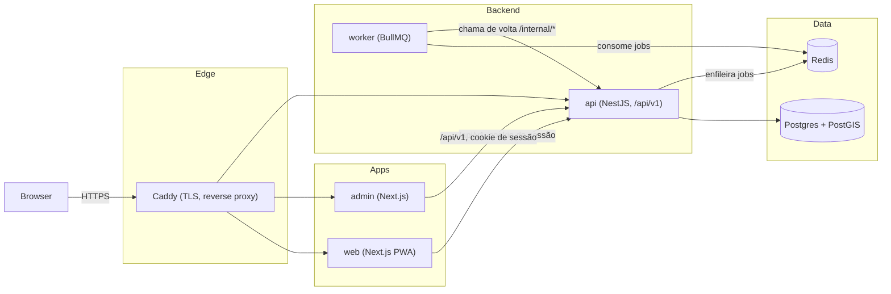

# Arquitetura — VALORI MATCH

## Visão geral

Monorepo pnpm (`turbo`) com 4 aplicações e 6 pacotes compartilhados.

**Apps** (`apps/*`):

| App | Stack | Papel |
|---|---|---|
| `web` | Next.js (App Router, PWA via serwist) | App do comprador |
| `admin` | Next.js (App Router) | Painel comercial (corretor/admin/incorporadora) |
| `api` | NestJS | API REST única (`/api/v1`), autenticação por cookie de sessão |
| `worker` | Node puro + BullMQ | Processa filas assíncronas e jobs repetíveis |

**Pacotes** (`packages/*`): `contracts` (schemas Zod + tipos compartilhados
entre API/front/worker), `domain` (regras puras — Match Engine, sem I/O),
`design-tokens` (cores/tipografia/espaçamento, fonte única consumida pelos
dois `tailwind.config.ts`), `ui-web` (biblioteca de componentes React
compartilhada entre `web` e `admin`), `api-client` (SDK HTTP tipado usado
pelos dois front-ends), `configs` (ESLint/TS config compartilhada).

## Topologia de runtime (produção)

7 serviços Docker Compose (`infrastructure/docker/docker-compose.prod.yml` —
rota manual Hostinger; `docker-compose.coolify.yml` na raiz — rota Coolify,
mesmo padrão): `postgres` (imagem `postgis/postgis`, não exposta à internet),
`redis`, `api`, `worker`, `web`, `admin`, `caddy` (borda/TLS, único serviço
com portas 80/443 publicadas).

## Camadas

### API (`apps/api`)

NestJS, um único processo HTTP. Middlewares globais em `main.ts`: `helmet`,
`cookieParser`, CORS com allowlist (`CORS_ALLOWED_ORIGINS`), `OriginGuard`
(valida `Origin`/`Referer` nas rotas de mutação), `HttpExceptionFilter`
(normaliza erros), `ThrottlerGuard` global (120 req/60s por IP+rota).
Documentação OpenAPI gerada automaticamente em `/api/docs`
(ver `docs/api/OPENAPI.md`).

### Worker (`apps/worker`)

Processo Node separado, sem servidor HTTP. Consome 4 filas BullMQ
(`match-recalc-buyer`, `match-recalc-property`, `radar-sweep`,
`automation-tick`) — as duas últimas são jobs repetíveis agendados no boot
do próprio worker (`RADAR_SWEEP_INTERVAL_MINUTES`/
`AUTOMATION_TICK_INTERVAL_MINUTES`). **Não duplica lógica de negócio**: ao
processar um job, chama de volta rotas `/internal/*` da API (autenticadas por
`INTERNAL_API_KEY`, nunca expostas ao navegador) — a API continua sendo a
única dona das regras de domínio.

### Web / Admin (`apps/web`, `apps/admin`)

Dois apps Next.js independentes, mesma versão do React, consumindo a mesma
API via `@spire/api-client` e os mesmos componentes via `@spire/ui-web`.
`web` é instalável como PWA (manifest + service worker via serwist,
`/offline`); `admin` não é PWA (uso interno, desktop).

### Match Engine (`packages/domain`)

Função pura de scoring (`computeMatchScore`), sem acesso a banco/rede — a
API monta o `BuyerMatchProfile`/`PropertyMatchInput` a partir do banco e
chama a função; o worker recalcula em lote via `/internal/*`. Pesos
configuráveis em Configurações (admin), com fallback para os padrões do
pacote.

## Decisões já documentadas (ADRs)

- `docs/architecture/ADR_NAVEGACAO.md` — navegação única de 5 abas do
  comprador.
- `docs/architecture/ADR_PWA_GEOLOCATION_LIMITS.md` — limites reais de
  geolocalização em PWA e como o Match Engine nunca penaliza por ausência
  de GPS.
- `docs/architecture/ADR_WEB_PWA_NATIVE_FUTURE.md` — caminho de migração
  para um app nativo futuro sem reescrever o Match Engine/contratos.
