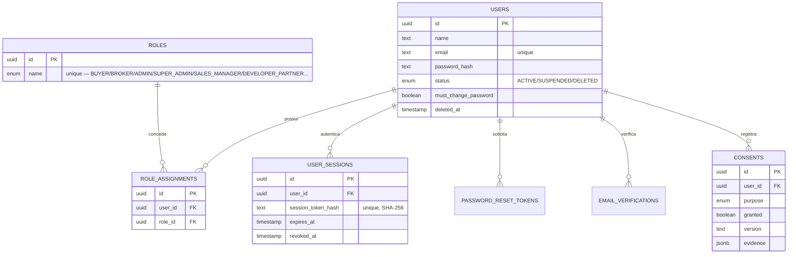
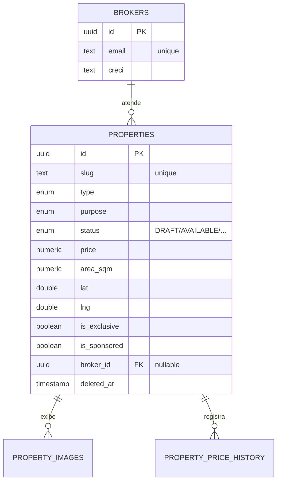
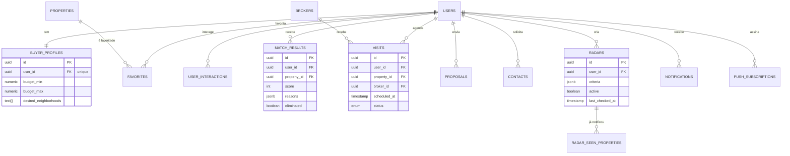
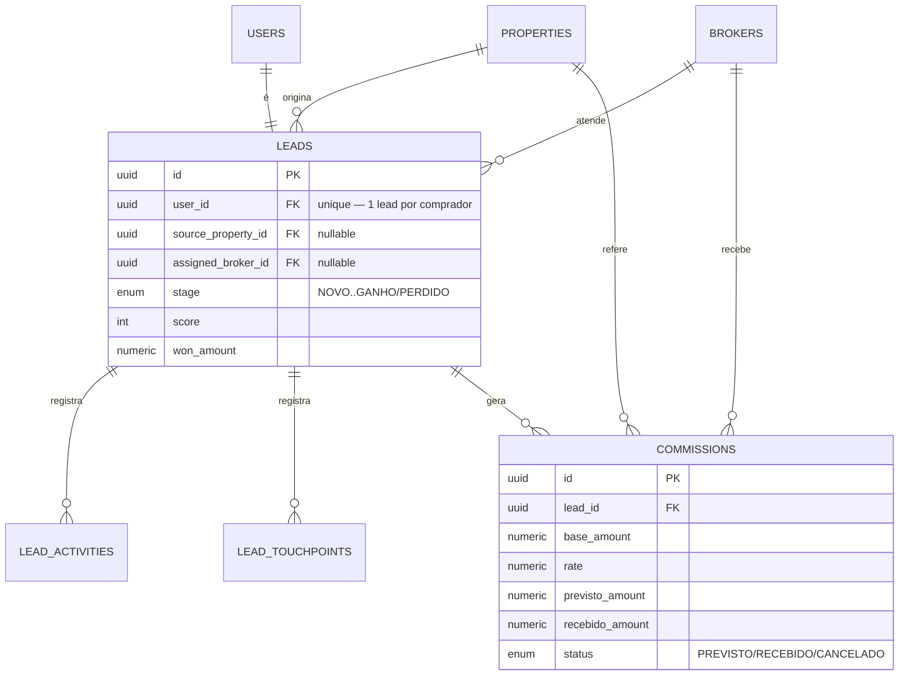
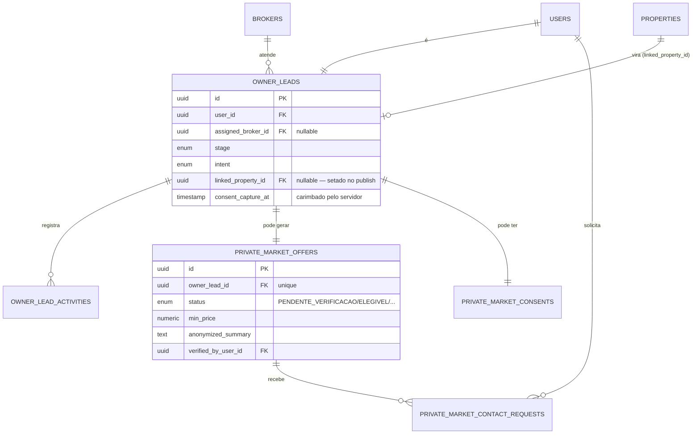
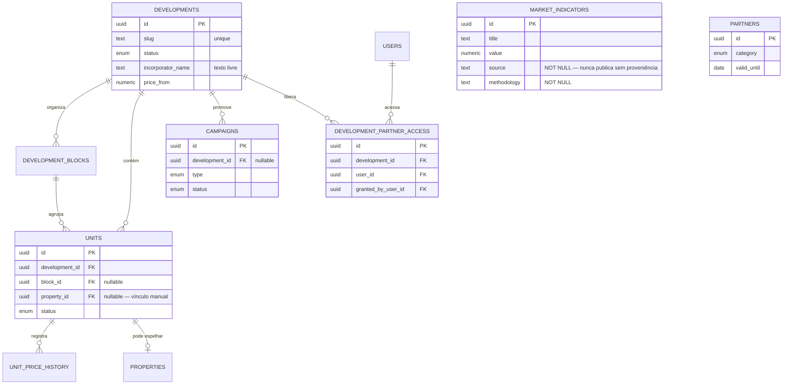
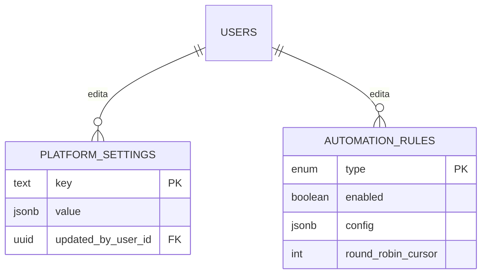
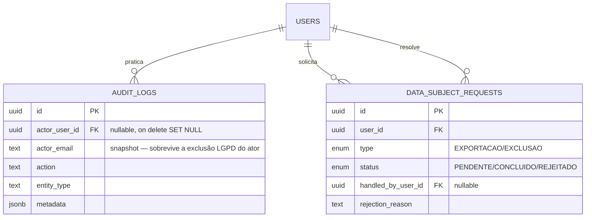
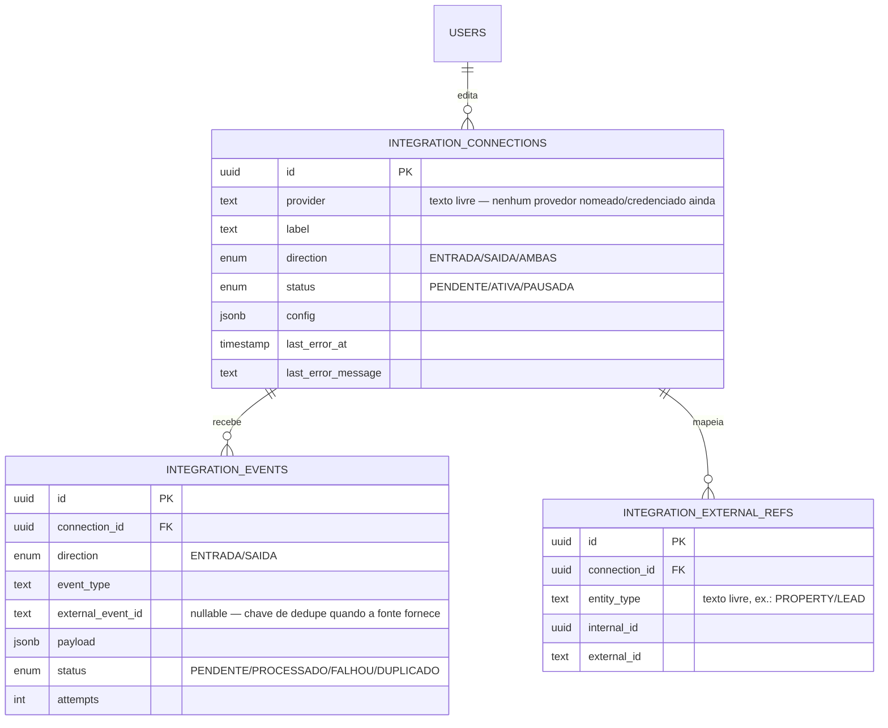

# ERD — VALORI MATCH

Gerado a partir do schema real em `apps/api/src/database/schema/*.ts` (Drizzle
ORM, Postgres). 46 tabelas em 9 grupos de domínio. Todo FK/coluna abaixo
existe hoje no código — nada aspiracional.

## 1. Identidade e acesso

`role_assignments` tem índice único `(user_id, role_id)` — um usuário pode ter
múltiplos papéis, mas nunca o mesmo papel duplicado. `consents` é append-only:
o consentimento vigente é a linha mais recente por `(user_id, purpose)`, nunca
um UPDATE.

## 2. Catálogo de imóveis

`properties` já nasceu indexada (`status`, `neighborhood`, `(lat,lng)`,
`price`) — ver `docs/database/MIGRATIONS_AND_INDEXES.md`. Localização é
`lat`/`lng` simples, não PostGIS `geography` — simplificação documentada no
próprio schema (comentário em `properties.ts`), suficiente para o volume
atual.

## 3. Comprador e engajamento

`match_results` tem índice único `(user_id, property_id)` — upsert, não
histórico (última pontuação calculada por par comprador/imóvel). `visits` tem
índice único **parcial** `(broker_id, scheduled_at) WHERE status != 'CANCELLED'`
— garante no banco que dois compradores nunca reservam o mesmo horário do
mesmo corretor.

## 4. CRM comercial (funil do comprador)

`leads.user_id` é único: o time comercial acompanha a pessoa, não um evento
isolado. `commissions` é criada automaticamente quando um lead vira `GANHO` —
`rate`/`previsto_amount` são um retrato do momento da criação (mudar a taxa
padrão depois não altera comissões já geradas).

## 5. Captação (proprietário) e Mercado Privado

Espelha o grupo 4 (mesmo pipeline comercial, dono dos dados diferente).
`linked_property_id` em `owner_leads` é o que fecha o laço "captação →
imóvel real no catálogo" (`OwnerLeadsService.publish`). `private_market_offers`
fica `PENDENTE_VERIFICACAO` até o time comercial preencher resumo anonimizado
+ preço mínimo.

## 6. Incorporadoras, parcerias e conteúdo

`development_partner_access` é a tabela que decide quais empreendimentos
aparecem para um usuário com papel `DEVELOPER_PARTNER` — concedida
explicitamente pelo time comercial, nunca automática; a segurança real está
nos guards de cada endpoint (ver `docs/security/RBAC.md`). `market_indicators`
(Pulse) e `partners` (Club) são cadastrados manualmente — sem provedor de
dados externo integrado ainda.

## 7. Configuração e automação

Chave/valor deliberado: uma linha por configuração, ausência de linha usa o
fallback de código documentado no `SettingsService` — nunca falha por
configuração ausente. `automation_rules` é uma linha por tipo (sem múltiplas
regras do mesmo tipo).

## 8. Auditoria e LGPD

`audit_logs.actor_email` é uma cópia, não um JOIN — sobrevive a uma exclusão
LGPD do próprio ator sem quebrar o histórico. `data_subject_requests` de tipo
`EXPORTACAO` já nasce `CONCLUIDO` (resolvida na hora); `EXCLUSAO` fica
`PENDENTE` até confirmação ou rejeição do time comercial (ver
`docs/security/LGPD_DATA_MAP.md`).

## 9. Integrações externas (fundação — "novos recursos" M1)

Fundação provider-agnóstica: nenhum conector concreto existe ainda (ver
`docs/product/NOVOS_RECURSOS_M0_DIAGNOSTICO.md`). `integration_events` tem
índice único parcial `(connection_id, external_event_id) WHERE external_event_id
IS NOT NULL` — dedupe real sob concorrência, não heurística em memória,
verificado contra Postgres real (não só mockado). "Isolar por imobiliária" é
tratado como isolar por CONEXÃO: o sistema é single-tenant (uma única
imobiliária), sem tabela de organização/tenant.
